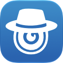

# Lock-Watcher

**macOS Surveillance Application for Security Monitoring**

Turn your Mac into a powerful surveillance system with Lock-Watcher. Detect and capture unauthorized access attempts discreetly, receiving high-quality photos or 1–5 second silent videos from your built-in or external camera and securely storing them locally or in the cloud.

## Company Information

**Company Name**: Agnidia
**Domain**: agnidia.com
**Contact**: info@agnidia.com

## Project Information

**Project Name**: Lock-Watcher
**Bundle Identifier**: com.igrsoft.Lock-Watcher
**Current Version**: 2.0.0 (Build 1704)

### Project Description

Lock-Watcher transforms your Mac into a stealthy security guardian. It monitors various system triggers - wake-up events, login attempts, power changes, USB connections, and wrong password entries - to detect potential unauthorized access. When triggered, it captures high-quality photos along with location, IP address, and network trace-route information, storing everything securely for later review.

## Features

- **Camera Selection** - Choose between built-in or external cameras for surveillance
- **Photo or Video Output** - Capture either high-quality photos or 1–5 second silent videos
- **Output Size Control** - Adjustable image and video size (Original, 1/2, 1/4) to optimize storage
- **JPEG Quality Settings** - Fine-tune photo compression for quality vs. storage balance
- **File Retention Control** - Keep local captures for 1 year, 1 month, 1 week, or remove after upload
- **Easy Configuration** - Simple setup for triggers and storage locations
- **iPhone Push Alerts** - Optional APNs alert to a paired iPhone, off by default ([details](#iphone-push-alerts))

### Security Triggers

- **On WakeUp** - Captures when Mac exits sleep mode
- **On Login** - Captures on user login events
- **On Battery Power Switch** - Captures when switching between AC and battery (laptops)
- **On USB Mount** - Captures when a removable or external drive is connected (disk images, network shares and internal volumes are ignored)
- **On Display Attach** - Captures when a display is connected while the Mac is locked
- **On Location Change** - Captures once when the Mac moves 500 m or more while locked
- **On Locked Input** - Captures on keyboard or mouse input while the Mac is locked
- **On Wrong Password** - Captures on failed login attempts (Non-MAS only)

### Snapshot Information

Each capture includes:
- Device location (GPS coordinates)
- Network IP address
- Network trace-route analysis
- Timestamp with date formatting

### Storage Options

- **Local Database** - Encrypted storage on your Mac
- **iCloud** - Sync to iCloud Drive
- **Dropbox** - Cloud backup via Dropbox
- **Mail** - Email delivery (Non-MAS only)

### Additional Features

- **Organized Files** - Date-formatted naming for easy retrieval
- **Customizable Menubar** - Icon indicator and notifications on triggers
- **Password Protection** - Secure access to snapshots and settings
- **Biometric Authentication** - Apple Watch and Touch ID keyboard support

## Technology Stack

- **Language**: Swift 6.4
- **UI Framework**: SwiftUI with AppKit integration
- **Minimum Platform**: macOS 15.0+
- **Architecture**: MVVM + Coordinator pattern
- **Concurrency**: Swift 6 strict concurrency
- **Storage**: EasyStash (encrypted local storage)
- **Cloud**: iCloud (CloudKit), Dropbox SDK
- **Camera**: CameraSnap library (photo or H.264 video capture)
- **Auto-Launch**: LaunchAtLogin
- **Privacy Manifest**: PrivacyInfo.xcprivacy with required API reason codes

## Requirements

- **macOS**: 15.0 or later
- **Hardware**: Mac with built-in or external camera
- **Xcode**: 27+ (for development)
- **Swift**: 6.4

## iPhone Push Alerts

Lock-Watcher sends each capture to a paired iPhone as an alert. The alert goes through Apple Push Notification service (APNs). The feature is off by default.

The iPhone runs the Lock-Watcher Companion app. Build it with the `Lock-Watcher-Companion` scheme. It requires iOS 17.0 or later.

### Pair an iPhone

1. Run the companion on the iPhone. Its Pair screen shows a QR code.
2. On the Mac, open the Push block in Settings and click Pair iPhone….
3. Scan the QR code with the Mac camera.
4. Turn on Push alerts to iPhone.

The QR code has this form:

```
lockwatcher://pair?v=1&token=<device token hex>&env=<sandbox|production>&topic=<bundle ID>
```

The QR code carries the device token. Show it only to the owner.

### Re-pair and Forget iPhone

Forget iPhone removes the stored pairing. It keeps the own key.

Re-pair iPhone appears in two cases. The pairing topic no longer matches the signing topic. APNs answers `400 BadDeviceToken` or `410` for the device token. In both cases, pair the iPhone again.

### Options and defaults

| Option | Where | Default | Effect |
|---|---|---|---|
| `isSendPushEnable` | Push block, "Push alerts to iPhone" | `false` | Sends each capture as an APNs alert when on |
| Own key ID, Team ID, Topic, PEM | Push block, "Own APNs key (advanced)" | empty | Replaces the embedded key for both environments |
| `COMPANION_BUNDLE_ID` | `Configurations/base.xcconfig` | `$(APP_DOMAIN).$(MAS_APP_NAME)`, which is `com.igrsoft.Lock-Watcher` | Companion bundle ID and APNs topic |
| `APS_ENVIRONMENT` | `Configurations/companion/companion-debug.xcconfig`, `Configurations/companion/companion-release.xcconfig` | `development` (Debug), `production` (Release) | APNs environment the companion registers for |
| `SECRETS_APNS_TEAM_ID` | Xcode Cloud secret, read by `ci_scripts/ci_post_clone.sh` | empty | Team ID of the embedded key |
| `SECRETS_APNS_SANDBOX_KEY_ID`, `SECRETS_APNS_SANDBOX_KEY_P8_BASE64` | Xcode Cloud secrets | empty; blanked for archive builds | Sandbox key, Debug builds only |
| `SECRETS_APNS_PRODUCTION_KEY_ID`, `SECRETS_APNS_PRODUCTION_KEY_P8_BASE64` | Xcode Cloud secrets | empty | Production key |

Code constants apply without a setting:

| Constant | Value | Source |
|---|---|---|
| Outbox capacity | 20 alerts, in memory only | `Source/Notifiers/PushNotifier.swift` |
| Alert expiry | 3600 s after the alert is created | `Source/Notifiers/PushNotifier.swift` |
| Send attempts on 429, 500, 503 | 3, with waits of 1 s and 2 s | `Source/Notifiers/PushNotifier.swift` |
| Drain of queued alerts after the network returns | 30 s | `Source/Notifiers/PushNotifier.swift` |
| Request timeout | 15 s | `Source/Utils/APNsClient.swift` |
| Payload size cap | 4096 bytes | `Shared/Push/PushAlertPayload.swift` |
| Payload target size (the trace route is trimmed to fit) | 3800 bytes | `Shared/Push/PushAlertPayload.swift` |
| Trace route length | 3000 characters at most | `Shared/Push/PushAlertPayload.swift` |
| Alert body length | 178 characters | `Shared/Push/PushAlertPayload.swift` |
| Photo file cap | 50 MB | `Companion/Core/CloudPhotoLibrary.swift` |
| Photo pixel cap | 32,000,000 pixels | `Companion/Core/CloudPhotoImageDecoder.swift` |
| Photo image cache | 120 images, 64 MB cost | `Companion/Core/CloudPhotoLibrary.swift` |

### Companion entitlements

Each entitlement exists for one reason.

| Entitlement | Reason |
|---|---|
| `aps-environment` | Registers the companion for APNs in the environment its build configuration sets. |
| `com.apple.developer.icloud-container-identifiers` | Names the iCloud container `iCloud.com.igrsoft.lockwatcher` that the Photos tab reads. |
| `com.apple.developer.icloud-services` | Enables the iCloud Documents service for that container. |
| `com.apple.developer.ubiquity-container-identifiers` | Lets the iCloud Documents API resolve the same container. |
| `com.apple.developer.usernotifications.time-sensitive` | Lets an alert use the time-sensitive interruption level that its payload requests. |

The companion bundle ID equals the MAS bundle ID by design. Both builds use the iCloud container `iCloud.com.igrsoft.lockwatcher`, and universal purchase needs one bundle ID. Check the key list with this command:

```bash
grep -o '<key>[^<]*</key>' Companion/Resources/Companion.entitlements
```

The command prints the five keys in the table above.

### Key handling

The Mac binary embeds one `.p8` key per environment. CI writes both keys into `Source/Application/Secrets.swift`, which git ignores.

The sandbox key compiles only under `#if DEBUG`. A Release build gets an empty sandbox key and fails closed with `missingConfiguration`.

For archive builds, `ci_scripts/ci_post_clone.sh` blanks the sandbox values. TestFlight and App Store builds carry the production key only.

An own key (BYOK) takes precedence over the embedded key. The Mac stores it in the Keychain, accessible after first unlock on this device only.

The owner attests that each key is used for APNs only, for this companion topic. Apple APNs keys are team-wide, so this rests on that attestation. No `.p8` file is tracked. Check it with this command, which prints nothing:

```bash
git ls-files '*.p8'
```

### Release Mac with a development companion

A Release Mac has no sandbox key. An iPhone built from Xcode registers for the development environment, so its pairing carries `env=sandbox`. Alerts then fail with `missingConfiguration`.

Save an own key on the Mac, or pair a TestFlight or App Store build. Those builds register for production.

### Owner steps in the Apple portal

1. In Certificates, Identifiers & Profiles, enable Push Notifications, Time Sensitive Notifications, and iCloud Documents for the App ID `com.igrsoft.Lock-Watcher`. Add the container `iCloud.com.igrsoft.lockwatcher`.
2. In App Store Connect, add an iOS platform to the existing Lock-Watcher app record, with the same bundle ID. This enables universal purchase.
3. Under Keys, create an APNs key. Store its Key ID, the Team ID, and the base64 of the `.p8` file as the Xcode Cloud secrets in the table above. Never commit the file or paste its content into a chat or an issue.
4. Archive in Xcode Cloud and distribute the build through TestFlight. Archives register for production only.

### Rotate the APNs key

1. Create a new APNs key. Record its Key ID.
2. In Xcode Cloud, replace `SECRETS_APNS_PRODUCTION_KEY_ID` and `SECRETS_APNS_PRODUCTION_KEY_P8_BASE64`. Replace the sandbox pair too when Debug builds use the new key.
3. Ship a Release Mac build with the new key.
4. Confirm that the owner runs the new Mac build.
5. Revoke the old key in the Apple Developer portal.

Old builds that hold a revoked key fail with a 403 from APNs. The app shows that failure as `rejected(403, reason)`. The app has no update prompt for this case yet.

### Alert detail (Pro)

A Pro user taps an alert to open its detail: the trigger and the Mac name, the time on the phone and on the Mac, a map with the coordinates, the IP address, the trace route, and the photo of the capture. A card appears only when the alert carries its data. The photo comes from the iCloud folder and is matched by file name. A free account sees a lock on each row, and a tap opens the Pro tab.

### Privacy and security

- Alerts cross Apple's APNs servers over TLS. The payload is not end-to-end encrypted.
- The payload carries the trigger name, the time, the time zone and the name of the Mac, and the latitude, longitude, IP address and trace route when the capture recorded them. It also carries the file name and kind (photo or video) of the capture, never its bytes. The Mac name can contain a person's name.
- The companion shows the extra fields in the alert detail view, which is part of Pro. The map in that view loads Apple Maps tiles.
- The Mac outbox lives in memory only. It holds 20 alerts for one hour. Alerts queued at quit are lost.
- The iPhone stores alert history with complete file protection. A failed load never overwrites unread history.
- The companion accepts any payload on its topic. The pairing carries no secret yet.
- The Mac binary embeds the key. Anyone who extracts it can send APNs alerts to this topic. The owner accepted this risk in the security review of this feature.
- The Photos tab reads the owner's iCloud Documents container and does not write to it. The caps in the constants table apply.

### Examples

Run the companion tests on an iOS Simulator. Replace `<simulator-udid>` with a simulator ID from `xcrun simctl list devices`.

```bash
xcodebuild test -project Lock-Watcher.xcodeproj -scheme Lock-Watcher-Companion -destination 'platform=iOS Simulator,id=<simulator-udid>' -only-testing:Lock-WatcherCompanionTests/AlertInboxTests
```

Expected last lines:

```
Executed 8 tests, with 0 failures (0 unexpected) in 0.013 (0.021) seconds
** TEST SUCCEEDED **
```

Run the Mac push notifier tests:

```bash
xcodebuild test -project Lock-Watcher.xcodeproj -scheme Lock-Watcher -destination 'platform=macOS' -only-testing:Lock-WatcherTests/PushNotifierTest
```

Expected summary line: `Executed 17 tests, with 0 failures (0 unexpected) in 0.028 (0.031) seconds`.

No runnable example exists for pairing or the push toggle. Both run only through the Settings UI and the camera, and no test entry point drives them.

## Project Structure

```
Lock-Watcher/
├── Source/                    # Main application source
│   ├── Application/           # App entry point and delegate
│   ├── Coordinator/           # Navigation coordination
│   ├── Managers/              # Core business logic
│   ├── Listeners/             # Event trigger listeners
│   ├── Notifiers/             # Output channel notifiers
│   ├── Views/                 # SwiftUI interface
│   ├── Models/                # Data structures
│   ├── Extensions/            # Swift extensions
│   ├── Utils/                 # Utility functions
│   └── Logger/                # Logging infrastructure
├── XPCServices/               # Privileged helper services
│   ├── XPCAuthentication/     # Biometric authentication
│   ├── XPCMail/               # Email delivery (Non-MAS)
│   └── XPCPower/              # Power management
├── Companion/                 # iOS companion app (iOS 17+)
├── Shared/                    # Codecs shared by the Mac and the companion
├── Tests/                     # Unit tests
├── UITests/                   # UI automation tests
├── Resources/                 # Assets and configuration
└── Configurations/            # Build configs (MAS/Non-MAS)
```

## Getting Started

### 1. Clone Repository

```bash
git clone <repository-url>
cd Lock-Watcher
```

### 2. Open in Xcode

```bash
open Lock-Watcher.xcodeproj
```

### 3. Build and Run

Select the appropriate scheme:
- **Lock-Watcher** - Mac App Store build
- **Lock-Watcher-non-mas** - Direct distribution build

Press `Cmd+R` to build and run.

## Building

### MAS (Mac App Store) Build

```bash
xcodebuild -project Lock-Watcher.xcodeproj \
           -scheme Lock-Watcher \
           -configuration Release \
           build
```

### Non-MAS (Direct Distribution) Build

```bash
xcodebuild -project Lock-Watcher.xcodeproj \
           -scheme Lock-Watcher-non-mas \
           -configuration Release \
           build
```

## Testing

### Run Unit Tests

```bash
xcodebuild test \
    -project Lock-Watcher.xcodeproj \
    -scheme Lock-Watcher \
    -destination 'platform=macOS'
```

### Run UI Tests

```bash
xcodebuild test \
    -project Lock-Watcher.xcodeproj \
    -scheme Lock-Watcher \
    -destination 'platform=macOS' \
    -only-testing:Lock-WatcherUITests
```

## Development

### Code Style

Project uses **SwiftFormat** for consistent code formatting:

```bash
swiftformat .
```

Configuration in `.swiftformat` file.

### Reset App Permissions

For development testing, reset all permissions:

```bash
tccutil reset All com.igrsoft.Lock-Watcher
```

### Build Configurations

| Config | Bundle ID | Features |
|--------|-----------|----------|
| MAS | com.igrsoft.Lock-Watcher | App Store compliant |
| Non-MAS | com.igrsoft.Lock-Watcher-nonmas | Full features (Mail, WrongPassword) |
| iOS companion | com.igrsoft.Lock-Watcher (same as MAS, by design) | APNs alerts, alert inbox, Photos viewer; no Non-MAS variant |

The companion setup and key handling are in [iPhone Push Alerts](#iphone-push-alerts).

## Privacy & Security

Lock-Watcher prioritizes your privacy and security:

- **No Third-Party Services**: Data is never sent to external analytics or tracking services. The optional iPhone push alerts send alert data through Apple's APNs servers. See [iPhone Push Alerts](#iphone-push-alerts)
- **Local Storage**: All captures stored locally or in your own cloud accounts
- **Encrypted Storage**: Local database uses encryption
- **Biometric Protection**: Optional Touch ID/Apple Watch authentication
- **Minimal Permissions**: Only requests necessary system permissions

## Contributing

### Before Committing

1. **Format code**: Run `swiftformat .`
2. **Run tests**: Ensure all tests pass
3. **Update docs**: If adding features

### Commit Message Format

Follow [Conventional Commits](https://www.conventionalcommits.org/):

```
feat: add new trigger type
fix: resolve camera capture issue
chore: update dependencies
docs: improve README
```

## Documentation

- [AGENTS.md](AGENTS.md) - AI development guidelines and agent configuration

## License

Copyright 2025 Agnidia. All rights reserved.

See [LICENSE](LICENSE) file for details.

## Download

Available on the [Mac App Store](https://apps.apple.com/app/lock-watcher/id1583462846)

## Contact

For issues or questions:
- Create an issue in this repository
- Contact: info@agnidia.dev

---

**Made with care by Agnidia**
